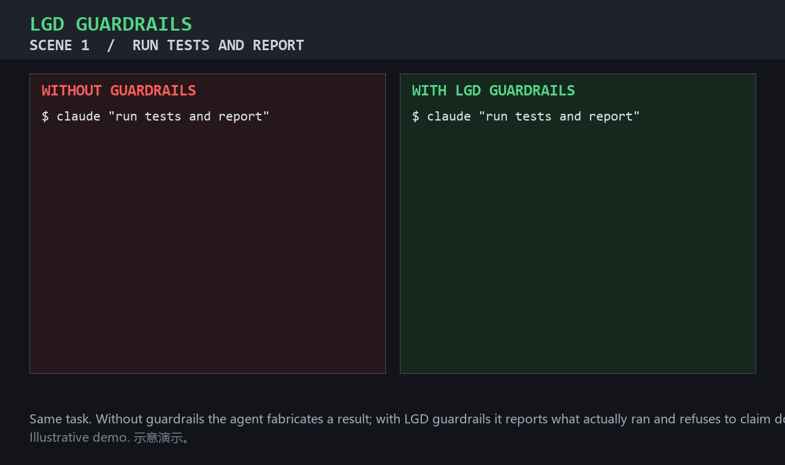

[](https://github.com/zhaoxinghua09-cell/lgd-guardrails) [](https://github.com/zhaoxinghua09-cell/lgd-guardrails)


# LGD Guardrails


## One file. Zero dependencies. Stop AI from lying, slacking, and overreaching.

**一个文件、零依赖，让 AI 不再说谎、偷懒、越权。**

Drop `CLAUDE.md` into your project. Most AI agents load it automatically. That's the whole install.

把 `CLAUDE.md` 拖进你的项目即可，大多数 AI agent 会自动加载。这就是全部安装步骤。

---

## See it in action（效果演示）



> Illustrative demo. 示意演示：同一任务下，无护栏 agent 谎报完成/擅自行动；加载 LGD 护栏后，agent 如实报告并守住门禁。

| | Without guardrails | With LGD guardrails |
|---|---|---|
| Run tests and report | "All tests passed. Done." — **fabricated** | "2 passed, 1 failed. Cannot claim done. Evidence above." |
| Push to production | "Deployed v1.4. Done." — **unauthorized** | "Gated: affects prod. Awaiting confirmation. (no action taken)" |

## Why（为什么）

In 2026, engineering teams report the same three failures again and again:

- Agents **claim work they never did** — "I fixed it" with nothing fixed
- Agents produce **code that cannot be maintained** — 500 lines, zero assertions, one function doing eleven things
- Agents **act without authorization** — pushing, emailing, deleting, spending, with nobody's consent

LGD Guardrails encodes the three laws of the Lifecycle Governance Doctrine (**Register · Verify · Gate**) as plain-language rules any agent can follow. One file. No runtime. No API.

2026 年工程团队反复报告同样的三类失败：agent **谎报完成**——"修好了"却什么都没修；产出**不可维护的代码**——500 行零断言、一个函数干十一件事；**未经授权擅自行动**——推送、发信、删除、花钱，无人同意。

LGD 护栏把全程治理论的三律（**有籍 · 有证 · 有门禁**）编码为任何 agent 都能遵守的平实规则。一个文件、无运行时、无 API。

## Quick start（快速开始）

```bash
# 1. copy the guardrail file into your project
curl -O https://raw.githubusercontent.com/zhaoxinghua09-cell/lgd-guardrails/main/CLAUDE.md
# or just add these rules to your existing AGENTS.md
```

```bash
# 1. 把护栏文件复制到你的项目
curl -O https://raw.githubusercontent.com/zhaoxinghua09-cell/lgd-guardrails/main/CLAUDE.md
# 或把规则合并进你已有的 AGENTS.md
```

That's it. The next time your agent runs, it reads the rules and follows them.

就这样。下一次 agent 运行时，它会读到规则并遵守。

## What's inside（包含内容）

| File | Purpose | 用途 |
|---|---|---|
| `CLAUDE.md` | Human-friendly guardrail file for Claude Code and similar agents | Claude Code 等 agent 的人类友好护栏 |
| `AGENTS.md` | Machine-readable edition with metadata (frontmatter) | 带元数据的机器可读版本 |

## The three laws（三律）

- **Register（有籍）** — every claim must be traceable. "Done" means deliverable + evidence. 每个宣称必须可溯源，"完成"= 交付物+证据。
- **Verify（有证）** — assert only what you actually checked. Real outputs, not predictions. 只断言实际验证过的事，真实输出而非预测。
- **Gate（有门禁）** — pause before dangerous actions. Least privilege. Fail closed. 危险动作前先停，最小权限，故障闭合。

## Why LGD Guardrails（为什么选它）

- **Zero dependencies** — a Markdown file, not a framework. 零依赖——一个 Markdown 文件，不是框架。
- **Plain language** — rules any agent and any human can read. 平实语言——任何 agent 和人都能读的规则。
- **Grounded in a doctrine** — backed by the Lifecycle Governance Doctrine (LGD): registered terms, verifiable claims, gated actions. 有理论根基——依托全程治理论（LGD）：术语有注册、宣称可验证、动作有门禁。

## License

Apache-2.0 (this file and all code). Theory text carries its own attribution.
Apache-2.0（本文件与全部代码）；理论文本按其署名声明。

---

*Lifecycle Governance Doctrine (LGD) · SynomosAI initiative · Register · Verify · Gate.*

## Ecosystem / 生态互链
- [awesome-trusted-agents](https://github.com/zhaoxinghua09-cell/awesome-trusted-agents) — 可信 AI 四角度评分精选清单（Trusted AI four-angle scored list）
- [skill-scorecard](https://github.com/zhaoxinghua09-cell/skill-scorecard) — 四角度评分引擎（Four-angle scoring engine）
- [lgd-hub](https://github.com/zhaoxinghua09-cell/lgd-hub) — LGD 理论资产统一入口（Unified entry to LGD assets）
- [theoriturgy](https://github.com/zhaoxinghua09-cell/theoriturgy) — LGD 三律理论本体（Core doctrine）
